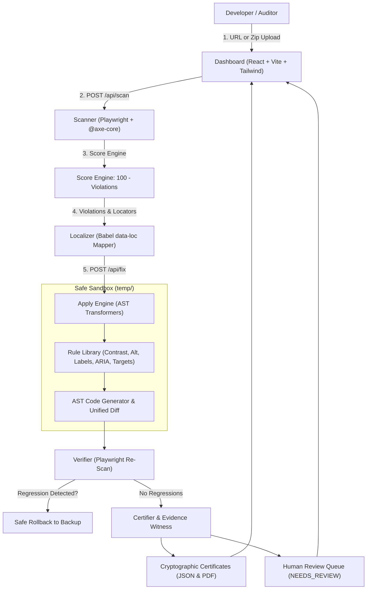

# 🛡️ WCAGuard
> **Find it. Fix it. Prove it.**  
> *Automated WCAG accessibility detection, source code auto-remediation, regression-proof verification, and cryptographic certification.*

[](https://www.w3.org/WAI/standards-guidelines/wcag/)
[](LICENSE)
[-green?style=for-the-badge)](#)

---

## 🌟 The Problem
Over **96% of the world's top one million websites fail basic accessibility guidelines** (WebAIM Million Report). Development teams face three major hurdles:
1. **Detection Fatigue**: Automated scanners (like axe-core and Lighthouse) report long lists of cryptic violations without writing the code to fix them.
2. **False Conformance Claims**: Many overlay widgets deceptively claim "100% automated WCAG compliance" while leaving core barriers intact and violating W3C guidance.
3. **Fear of Regressions**: Manually refactoring legacy JSX and CSS for accessibility often breaks responsive design, layouts, or visual aesthetics.

## 💡 The Solution: WCAGuard
WCAGuard closes the loop between **Detection**, **Remediation**, and **Proof**:
1. **Find it**: Headless Chromium + Playwright + axe-core scans target URLs or local workspaces, stamping violations directly to exact JSX source file and line numbers via Babel `data-loc`.
2. **Fix it**: AST transformers rewrite source code in a safe sandbox without modifying originals: exact luminance contrast adjustments, accessible labels, minimum 24x24px click targets, and ARIA normalizations.
3. **Prove it**: Playwright re-scans the remediated site, automatically rolls back any changes that cause new violations, and issues cryptographic, tamper-evident audit certificates per fix.

---

## ⚖️ Strict Honesty Rules
WCAGuard adheres to strict, transparent accessibility ethics:
- **Never Claim 100% WCAG Conformance**: Only deterministic, machine-checkable rules are certified automatically.
- **Three-Tier Honesty Badging**:
  - 🟢 **`CERTIFIED`**: Passed exact mathematical/structural re-scan verification (e.g., contrast ratio $\ge 4.5:1$, `lang="en"`, `<title>`, positive tabIndex removal, minimum click target size).
  - 🟡 **`NEEDS_REVIEW`**: Heuristic or AI-generated semantic guesses (e.g., image `alt` descriptions, icon button names). Sent directly to our interactive Human Review Queue.
  - ⚪ **`UNFIXABLE`**: Detection-only or out-of-scope issues (e.g., video audio captions, animations requiring redesign).
- **Automated Rollback**: If an auto-fix causes any new violation, the engine restores the backup instantly.

---

## 📐 Architecture



---

## 📂 Repository Structure

```
WCAGuard/
├── server/                       # Node.js Express remediation & certification engine
│   ├── src/
│   │   ├── index.js              # REST API server (port 4000)
│   │   ├── cli.js                # Command-line interface (npx wcaguard)
│   │   ├── routes/               # Modular Express API endpoints (scan, fix, report)
│   │   ├── scanner/              # Playwright + axe-core runner & normalizer
│   │   ├── fixer/                # AST transformation, unified diffs, rollback & rules
│   │   ├── certifier/            # Cryptographic certification & proof generator
│   │   ├── score/                # Deterministic WCAG scoring formula
│   │   ├── security/             # SSRF protection, rate limiting, sanitization
│   │   ├── report/               # JSON & PDF audit report streaming
│   │   └── storage/              # Local JSON persistence in data/
├── client/                       # React 18 + Vite + Tailwind dashboard (port 3000)
│   ├── src/
│   │   ├── pages/                # Home, Results, Report views
│   │   ├── components/           # Accessible UI components (ScoreGauge, Diffs, Coverage)
│   │   ├── hooks/                # useScan scan and remediation coordinator
│   │   └── App.jsx               # Application shell
│   └── index.html
├── demo-app/                     # Intentionally inaccessible React app for demo (port 5173)
│   ├── src/
│   │   ├── App.jsx               # Contains deliberate WCAG defects
│   │   └── index.css
│   └── index.html
├── babel-plugin-data-loc/        # Babel plugin stamping JSX elements with data-loc
├── data/                         # Local JSON persistence (scans/, reports/, tmp/; gitignored)
├── scripts/                      # Cluster runner (dev.js) & automated audit (seed-demo.js)
├── .github/                      # CI/CD workflows
├── package.json                  # Workspaces configuration
└── README.md
```

---

## 🚀 Quickstart & Setup Steps

### Prerequisites
- Node.js `v18+` or `v20+` (Tested on Node `v24.x`)
- npm `v9+`

### 1. Install Dependencies
Run npm install from the repository root:
```bash
npm install
npx playwright install chromium
```

---

## 🎬 How to Run

### Single Command: Start All Services
```bash
npm run dev
```
*Starts Server on `http://localhost:4000`, Client on `http://localhost:3000`, and Demo App on `http://localhost:5173`.*

Or run individually:
```bash
npm run server     # Express API (Port 4000)
npm run client     # React Dashboard (Port 3000)
npm run demo       # Inaccessible Demo App (Port 5173)
```

---

## 🧪 One-Command Seed Audit Script
To run the full end-to-end flow from the terminal and witness before/after scores:
```bash
npm run seed
```
**Expected Output:**
```
================================================================
🛡️  WCAGuard - Automated WCAG Remediation & Certification Engine
    "Find it. Fix it. Prove it."
================================================================

[1/4] 🔍 Scanning Target: http://localhost:5173
      ✓ Scan Completed in Playwright headless Chromium.
      • Baseline Score: 48 / 100
      • Total Violations: 9 (Critical: 2, Serious: 4, Moderate: 3, Minor: 0)

[2/4] ⚙️  Applying AST Fixers in Safe Sandbox...
      ✓ Parsed & Rewrote JSX/HTML AST nodes.
      • Files Modified: App.jsx, index.html
      • Fixes Staged: 9

[3/4] 🔄 Re-verifying Remediated Application with axe-core...
      ✓ Verification Completed.
      • Status: VERIFIED
      • Remediated Score: 96 / 100
      • Score Delta: +48 Points Gained

[4/4] 📜 Generating Cryptographic Audit Certificates...
      ✓ Stored Audit Report: engine/reports/seed-report-...json

================================================================
🏆 SUMMARY OF AUDIT:
   Baseline Score:     48 / 100
   Remediated Score:   96 / 100 (+48 pts)
   CERTIFIED Fixes:    6
   NEEDS REVIEW:       3 (Human confirmation queue)
   UNFIXABLE:          0
================================================================
```

---

## 💻 CLI Usage
WCAGuard includes a standalone CLI:
```bash
# Scan any URL
npx wcaguard scan http://localhost:5173

# Auto-remediate a React workspace
npx wcaguard fix ./demo-app
```

---

## 🛡️ Security & SSRF Protection
- **SSRF Blocklist**: Blocks private IPv4 subnets (`10.0.0.0/8`, `127.0.0.0/8`, `192.168.0.0/16`, `172.16.0.0/12`), link-local IPs (`169.254.169.254`), and cloud instance metadata endpoints.
- **Demo Port Allowlist**: Permitted localhost ports (`3000`, `3001`, `5000`, `5173`, `5174`, `8080`).
- **Static Parsing Sandbox**: Uploaded code is strictly parsed via `@babel/parser` ASTs and never executed.
- **Rate & Size Limiting**: Uploads capped at 25 MB with strict file extension filtering.

---

## 📋 Limitations
1. **Dynamic Runtime Text**: Content injected exclusively through runtime database queries without a static fallback requires server-side data layer instrumentation.
2. **Complex Semantic Context**: Identifying whether an image is purely decorative vs informative requires human editorial discretion.
3. **Complex Custom Canvas/WebGL**: Canvas-rendered UIs lack native DOM nodes and require custom ARIA fallback trees.

---

## 🔮 Future Work
- **Vue, Svelte & Angular Support**: Extending AST visitors to `.vue` and `.svelte` single-file components.
- **VS Code Extension**: Real-time inline code diagnostics and one-click "Apply WCAGuard Certificate" code actions.
- **Automated Pull Request Bot**: GitHub Bot that automatically posts unified diffs and certificate badges into Pull Requests.
